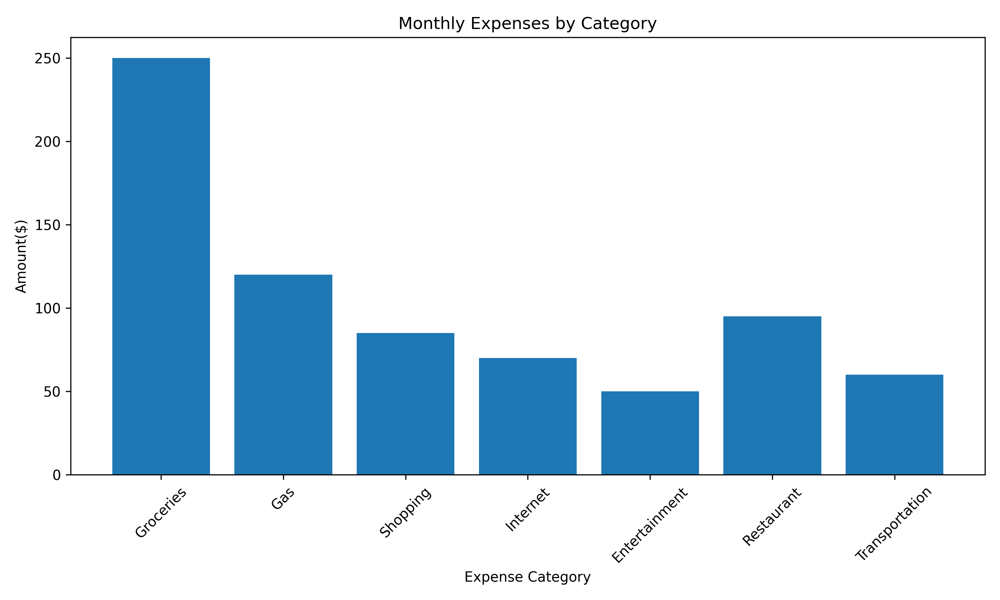

# Personal Expense Analysis

## Project Overview
This is my first data analysis portfolio project. I used a fictional dataset to analyze expenses across seven categories using Python.

## Tools Used
- Python
- Pandas
- Matplotlib
- Google Colab

## Project Objectives
- Organize expense data using a Pandas DataFrame.
- Calculate total, average, highest, and lowest expenses.
- Check for missing values and duplicates.
- Create a bar chart to visualize spending.

## Key Findings
The total expenses are $730 across seven categories. Groceries has the highest spending at $250, while Entertainment has the lowest at $50. The bar chart makes it easier to compare spending between categories.

## What I Learned
I learned how to organize and analyze data using Python and Pandas. I also practiced checking data quality and creating charts using Matplotlib.

## Data Visualization

